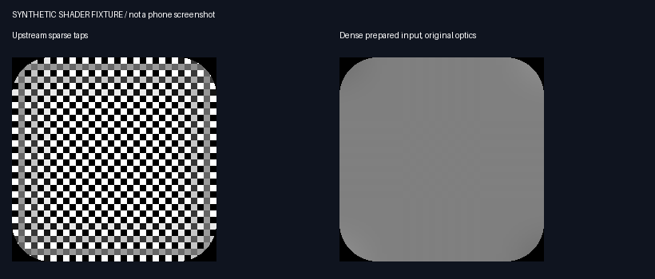

# 密集背景预模糊：消除网格/马赛克纹理

基于上游 0.2.1（aa96e1aeb98f4e3777f4bced265a1b86bf3e10cd），贡献自 DreamGlass 的高精度背景处理方案。此补丁保留上游应用标识、界面、版本、偏好格式及玻璃光学计算；仅修改快照模糊和对应输入绑定。

## 原因

原 `gaussianBlur` 使用 7×7 个稀疏 tap，间距 `blurRadius × sqrt(2) / 3`。模糊较大时，tap 可能反复命中背景细节的同一相位，把文字或周期纹理采成网格；截图放大时未明确线性插值会进一步放大像素块。提高浮点精度本身不能补回被跳过的空间采样。

## 实现

- `BackdropBlur` 对共享截图执行五轮可分离、含分数边缘权重的盒式高斯近似，每一源像素都参与计算。预乘 ARGB 使用 Float 中间值、Double 滑动求和，返回浮点数据；原近似模糊强度换算为 sigma≈0.8×radius，再按截图密度折算。
- 保留原捕获密度；仅对超大输入限制为约1048576像素/2048px长边，不随半径增大而降低密度。过大的输入分级线性缩放，避免一次大倍率缩放跳过细节。
- `BackdropWorker` 在后台输出 sRGB、预乘 RGBA_F16。单线程、四种样式的有界缓存、每样式仅保留最新待处理帧；整个 worker 每100ms最多启动一次计算。任务可在滤波轮次间取消，错误报告也被隔离；普通失败退避2秒，内存不足退避30秒。已交给着色器的位图不手动回收。
- `BackdropBinding` 一次返回位图、对应源坐标和材质参数，首次创建、刷新、流体云直接绘制三条路径共用。刷新从同一个快照解析图像和覆盖区域，兼容区域截图；异步结果改变时，实际位图和参数指纹会触发重新绑定。
- `uSourcePreblurred` 默认为false。准备完成时直接采样密集结果，不再叠加49个稀疏tap；原始/非截图路径保持原分支。两种 BitmapShader 显式使用线性过滤（API33及以上）。
- 零模糊直接使用原图。等待或暂时失败时采用不超过1.5px的紧凑临时滤波，避免先显示一帧宽间距网格；因此等待期间会暂时更清晰。

原始截图仍供其他取色逻辑使用。未复制 DreamGlass 的 UI、COS17 Hook 适配、IOS风预设、光照/折射优化或全局抓屏功耗策略。

## 验证与复现

使用 JDK17、Android SDK36、Gradle8.14.2：

```sh
gradle :app:assembleRelease :app:assembleDebug :app:testReleaseUnitTest
python tests/validate_dense_blur.py --output build/dense-blur-validation
```

Python 渲染检查需要 skia-python、numpy、Pillow；可用 `--skia-path` 指定现成环境。上游未附 Gradle wrapper，本地验证借用相同版本的外部运行器；镜像缓存通过仓库外 init 脚本接入，没有更改项目仓库配置。

- Release/Debug 构建和18项 JVM 数值测试通过：方差、密集参考、分数精度、预乘透明度、边缘、小图、密度预算、取消与输入不变等。
- 实际 AGSL 的 BASE/FULL 编译及12组形状/模糊回归通过；去掉本补丁的输入标记和直接采样分支后，AGSL 与基线逐字一致，原始输入模式输出相同，形状覆盖不变。
- 下图是专门与稀疏间距对齐的合成纹理。内部标准差从约0.50降至0.00196。它是离线着色器输入检查；预模糊固定输入由 Pillow 生成，不冒充生产 CPU 滤波结果，也不是手机截图。



- 独立 API33 模拟器执行生产 F16 打包、四种半径及截图/非截图/零值/等待/就绪/裁剪绑定；另一探针执行异常回调、错误报告二次异常、120次换帧/几何切换、取消后恢复和已发布位图所有权检查。两者通过。调试探针仅在debug APK中。
- 探针入口：`com.coloros16.liquidglass/.blur.BackdropBlurProbeActivity` 与 `.blur.BackdropStressProbeActivity`。验证图片与机器可读摘要位于 `docs/validation/dense-blur/`。
- `lintRelease` 仍失败。与未修改基线比较，排除忽略文件 local.properties 的本机路径格式提示后，两边均有150条既有错误，本补丁新增错误为0；新增4条风格建议（3条UseKtx、1条UseTomlInstead），没有屏蔽上游问题。

## 边界与代价

后台全图滤波增加 CPU 和内存开销，并以减少着色阶段稀疏采样为取舍；四种不同半径同时活跃时，后台更新可能比显示帧率慢，继续使用上一张有效结果。不能恢复原截图已经丢失的细节。

本次没有连接实体手机，没有验证 ColorOS16/17 厂商 Hook、真实观感、动画延迟、功耗或长期内存表现。模拟器使用软件GPU，不能替代手机驱动验证。未声称已量化省电或完全解决所有模糊问题。

贡献者：V0idream / DreamGlass，2026-10-28。新增密集滤波及绑定代码按本项目 GPL-3.0 分发；保留现有源文件及上游着色器的来源关系。
